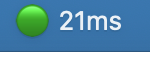

# swiftbar-net-watch

맥 메뉴바에 지금 연결 상태를 늘 띄워 두는 SwiftBar 플러그인입니다. 30초마다 공유기와 자주 쓰는 서버(기본값은 github.com, api.anthropic.com)에 ping을 보내 지연과 손실을 보여 주고, 연결이 끊기면 알림을 보냅니다.



와이파이가 느려져도 앱 화면을 보고 있으면 내 컴퓨터 문제인지, 서비스 문제인지, 통신 문제인지 알기 어렵습니다. 이 플러그인은 메뉴바에 뜬 색과 숫자로 그 답을 줍니다.

## 무엇을 보여 주나

메뉴바에는 상태가 짧게 한 줄로 뜹니다.

| 표시 | 뜻 |
|---|---|
| 🟢 18ms | 정상입니다. 숫자는 감시 서버 중 가장 느린 곳의 평균 지연입니다 |
| 🟡 210ms 또는 🟡 손실 20% | 느리거나 패킷이 조금 사라지고 있습니다 |
| 🔴 손실 100% 또는 🔴 끊김 | 서버가 응답하지 않습니다 |
| 🔴 오프라인 | 연결된 네트워크가 없습니다 |

메뉴를 펼치면 아래처럼 보입니다.

```text
회선이나 외부 구간 문제 (공유기까지는 정상)
──────────
🟢 공유기 192.168.0.1   12ms, 손실 0%
🔴 github.com          응답 없음, 손실 100%
🟢 api.anthropic.com   15ms, 손실 0%
──────────
en0, 10:53:26 측정
지금 다시 재기
```

첫 줄은 어느 구간이 문제인지 알려 줍니다. 공유기까지가 느리면 와이파이 구간 문제이고, 공유기까지는 괜찮은데 바깥이 느리면 회선이나 상대 서버 문제입니다. 와이파이를 옮길지, 기다릴지를 여기서 정하면 됩니다.

## 설치

1. SwiftBar를 설치합니다. SwiftBar는 무료 오픈소스 앱입니다.

   ```bash
   brew install --cask swiftbar
   ```

2. 플러그인을 둘 폴더를 만들고 스크립트를 내려받습니다.

   ```bash
   mkdir -p ~/SwiftBar
   ```

   ```bash
   curl -fsSL https://raw.githubusercontent.com/ggplab/swiftbar-net-watch/main/net-watch.30s.sh -o ~/SwiftBar/net-watch.30s.sh
   ```

   ```bash
   chmod +x ~/SwiftBar/net-watch.30s.sh
   ```

3. SwiftBar를 엽니다. 처음 열면 플러그인 폴더를 묻습니다. 2단계에서 만든 `~/SwiftBar`를 고릅니다.

   ```bash
   open -a SwiftBar
   ```

4. 아래 세 가지를 켭니다.
   - 처음 끊김 알림이 갈 때 macOS가 SwiftBar 알림을 허용할지 묻습니다. 허용을 누릅니다.
   - SwiftBar 메뉴의 설정에서 Launch at login을 켭니다. 켜지 않으면 재부팅한 뒤 다시 켜지지 않습니다.
   - 노치가 있는 맥북은 메뉴바 아이콘이 많으면 노치 뒤로 숨습니다. ⌘를 누른 채 아이콘을 끌어 오른쪽으로 옮깁니다.

파일명의 `30s`가 실행 간격입니다. 1분마다 재고 싶으면 파일명을 `net-watch.1m.sh`로 바꿉니다.

## 설정

스크립트를 고치지 않고 설정 파일로 바꿉니다. 그래야 새 판을 받아도 설정이 그대로 유지됩니다.

```bash
mkdir -p ~/.config/net-watch
```

```bash
curl -fsSL https://raw.githubusercontent.com/ggplab/swiftbar-net-watch/main/config.example -o ~/.config/net-watch/config
```

| 항목 | 기본값 | 뜻 |
|---|---|---|
| `HOSTS` | `(github.com api.anthropic.com)` | 감시할 서버. ping에 응답하는 곳이어야 합니다 |
| `EXT_WARN_MS` | 150 | 서버 평균 지연이 이 값(ms)을 넘으면 노랑 |
| `GW_WARN_MS` | 30 | 공유기 평균 지연이 이 값(ms)을 넘으면 노랑 |
| `RED_LOSS` | 50 | 손실률이 이 값(%) 이상이면 빨강 |
| `RED_STREAK` | 2 | 빨강이 이 횟수만큼 이어지면 알림. 30초 간격이면 약 1분입니다 |
| `NOTIFY` | 1 | 0이면 알림을 보내지 않습니다 |
| `DIAG_SCRIPT` | 없음 | 메뉴에서 바로 돌릴 진단 스크립트 경로 |

설정 파일이 있으면 메뉴에 "설정 파일 열기"가 생깁니다.

## 알림

- 빨강이 `RED_STREAK`번 이어지면 알림을 한 번 보냅니다.
- 회복하면 한 번 더 알립니다.
- 같은 상태가 이어지는 동안에는 다시 알리지 않습니다.

## 알아 둘 점

- **ping을 막는 곳**: 회사망이나 일부 공용 와이파이는 바깥으로 나가는 ping을 막습니다. 그러면 연결이 멀쩡해도 빨강으로 보입니다. 이때는 그 망에서 ping에 응답하는 서버로 `HOSTS`를 바꿉니다.
- **공유기가 ping에 답하지 않는 경우**: 호텔이나 행사장 와이파이에서 흔합니다. 공유기는 응답이 없고 바깥 서버는 응답하면, 공유기를 판정에서 빼고 ⚪로 표시합니다.
- **VPN을 켠 경우**: 기본 경로에 공유기 주소가 없으면 공유기 측정을 건너뛰고 외부 서버를 잽니다.
- **ping은 통신 경로를 잽니다**: 서버까지 길이 막혔는지는 알 수 있지만, 서비스 자체가 느린 것(예: API 서버의 응답 지연)은 잡지 못합니다.

## 끄기와 지우기

- 잠깐 끄려면 SwiftBar를 종료합니다.
- 이 플러그인을 지우려면 플러그인 폴더에서 `net-watch.30s.sh`를 지웁니다. 상태 파일은 `~/Library/Caches/net-watch/`에 있습니다.
- SwiftBar까지 지우려면 아래 명령을 씁니다.

  ```bash
  brew uninstall --cask swiftbar
  ```

## 필요 환경

- macOS (Apple Silicon, Intel 모두 됩니다. 기본 명령 `ping`, `route`를 씁니다)
- [SwiftBar](https://github.com/swiftbar/SwiftBar)

## 라이선스

[MIT](LICENSE). 고쳐 쓰고 다시 나눠도 됩니다.

© 2026 BuildnWrite
